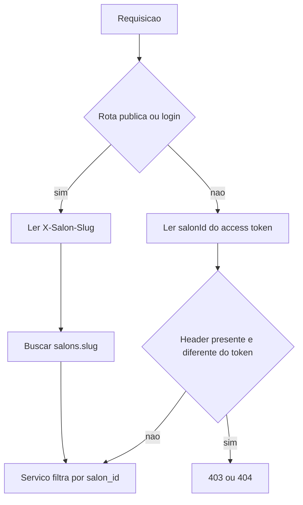

# PRD: Backend SaaS para N aplicações de salão

## 1. Problema

O backend em [Backend-Studio-Ester](C:\AppEster\Backend-Studio-Ester) já grava `salon_id` em usuários, profissionais, serviços, clientes, agendamentos, despesas e notificações, e o JWT já carrega `salonId`. O produto, porém, ainda é um salão fixo.

Pontos que impedem um segundo salão no mesmo processo:

- O schema declara "Salão único e fixo" em [src/db/migrate.ts](../src/db/migrate.ts) e o seed usa `SELECT id FROM salons LIMIT 1`.
- `users.email` é único no banco inteiro, e o telefone é único entre todos os usuários e clientes em [src/lib/phoneAccount.ts](../src/lib/phoneAccount.ts).
- O cadastro público em [src/services/clientsService.ts](../src/services/clientsService.ts) liga o cliente ao primeiro salão (`ORDER BY created_at ASC LIMIT 1`).
- Nome, e-mail, VAPID, WhatsApp, Twilio e SMTP vêm de variáveis de ambiente em [src/config/env.ts](../src/config/env.ts), com default `Studio Ana Ester`.
- Fuso `America/Sao_Paulo` está fixo em [src/lib/time.ts](../src/lib/time.ts) e nas queries de agenda.
- CORS em [src/app.ts](../src/app.ts) libera hosts do app Ester.

O app em [app-studio-ester-rodrigues](C:\AppEster\app-studio-ester-rodrigues) não escolhe salão: uma URL de API, um contexto e a marca "Studio Ana Ester". As respostas de `/api/*` não trazem `salonId`.

## 2. Objetivo

Um backend, um banco PostgreSQL e N salões. Cada aplicação de salão é um frontend de uma marca, apontando para esse backend e identificando o seu salão. O Studio Ana Ester é o primeiro tenant, com os dados atuais preservados.

O domínio continua sendo operação de salão (agenda, profissionais, serviços, clientes, despesas, papéis). Agnóstico aqui significa agnóstico de marca e de tenant, não de segmento.

## 3. Fora de escopo

- Troca de salão dentro do mesmo app, marketplace ou diretório público de salões.
- Cobrança da plataforma (planos, assinatura do SaaS).
- Comissão de profissionais.
- Tradução de papéis, status e categorias para outro idioma.
- Telefone fora do padrão brasileiro.
- Row Level Security no Postgres na primeira entrega.
- Credencial de WhatsApp, SMTP, Twilio e VAPID por salão na primeira entrega (fica para uma fase posterior).
- Reescrever o frontend além do envio do slug do salão.

## 4. Decisões

- **Identidade por salão.** Uma pessoa em dois salões tem duas contas. Não há usuário global com vínculo em vários salões. Isso combina com o `users.salon_id` atual e com apps que não trocam de salão.
- **Tenant autenticado vem do JWT.** O cliente não envia `salonId` no corpo para autorizar. Se o header de slug divergir do token, a API responde 403.
- **Tenant público vem do slug.** Login, recuperação de senha e cadastro de cliente exigem o salão antes da senha.
- **Provisionamento por chave de plataforma.** `POST /api/platform/salons` autenticado por `PLATFORM_API_KEY`. Sem papel novo na tabela `users` nesta entrega.
- **Duas camadas de regra.**
  - Iguais para todo salão: papéis `dono | recepcao | profissional | cliente`, máquina de status do agendamento, categorias e tipos de despesa, duração mínima de serviço (15 min), recorrência mensal.
  - Por salão: nome, slug, contato, endereço, fuso, moeda, locale, cor da marca, origens de frontend, antecedência de cancelamento do cliente (default 120 minutos).

## 5. Resolução de tenant

- Header `X-Salon-Slug` nas rotas sem JWT e no login.
- Rotas autenticadas ignoram slug ausente e usam o `salonId` do token.
- Slug desconhecido responde 404 com a mesma mensagem genérica do salão inexistente, sem diferenciar "não existe" de "sem permissão" nas rotas de dados.
- Domínio customizado (Host → slug) fica fora da primeira entrega.

## 6. Requisitos funcionais

**Provisionamento**

- Criar salão com nome, slug, fuso, moeda, locale e o primeiro `dono` (nome, e-mail, senha, telefone).
- Slug único, minúsculo, `[a-z0-9-]`.
- O salão já existente no banco recebe slug `ana-ester`, fuso `America/Sao_Paulo`, moeda `BRL`, locale `pt-BR`, e as origens Vercel atuais do app Ester.

**Identidade**

- Unicidade de e-mail passa de `UNIQUE(email)` para única em `(salon_id, lower(email))`.
- Telefone de usuário e de cliente é único dentro do salão, não no banco inteiro.
- Login, "esqueci a senha" e verificação de código buscam o identificador só naquele slug.
- A mensagem de recuperação continua genérica, para não revelar se o telefone existe em outro salão.
- O JWT segue com `sub`, `role`, `salonId`, `type: access`.

**Cadastro público**

- `POST /api/public/clients/register` cria usuário `cliente` e ficha de cliente no salão do slug. Deixa de usar o primeiro salão da tabela.

**Configuração e comunicação**

- Notificações, push, e-mail e SMS usam o nome e a cor do salão lidos do banco. `SALON_NAME` deixa de ser a fonte da marca.
- Filtros de dia da agenda e do dashboard usam o fuso do salão, no lugar do literal `America/Sao_Paulo`.
- Cancelamento pelo cliente respeita `client_cancel_lead_minutes` do salão, default 120.
- WhatsApp, Twilio, SMTP e VAPID continuam nas variáveis de ambiente, compartilhados, com o texto personalizado por salão.

**CORS**

- Origens permitidas = `FRONTEND_URL` + `frontend_origins` dos salões ativos.
- Os hosts Ester hardcoded saem de [src/app.ts](../src/app.ts) e passam a ser dados do tenant `ana-ester`.

**Contrato do app atual**

- Formatos de resposta de clientes, profissionais, serviços, agenda, despesas, totais, notificações e papéis permanecem.
- O app Ana Ester passa a enviar `X-Salon-Slug: ana-ester` a partir de uma constante de ambiente (`NEXT_PUBLIC_SALON_SLUG`), em [src/lib/api.ts](C:\AppEster\app-studio-ester-rodrigues\src\lib\api.ts). Sem seletor de salão na interface.

## 7. Modelo de dados

Estender `salons` (hoje só `id`, `name`, `phone`, `address`):

- `slug` único e obrigatório
- `timezone` (default `America/Sao_Paulo`)
- `currency` (default `BRL`)
- `locale` (default `pt-BR`)
- `contact_email`
- `brand_color` (default da cor atual do e-mail, `#7c2d3e`, só no tenant Ana Ester; novos salões têm default neutro)
- `frontend_origins` (text array)
- `client_cancel_lead_minutes` (default 120)
- `active`

Ajustes de unicidade:

- Remover `UNIQUE(email)` e criar índice único `(salon_id, lower(email))`.
- Telefone único por salão fica na aplicação, com o mesmo critério de dígitos já usado em `phoneAccount.ts`, sempre com predicado `salon_id`.
- `idx_clients_user_id` global pode permanecer: um usuário continua ligado a no máximo uma ficha, e o usuário já pertence a um salão.

Segredos por salão não entram neste schema. Quando existirem, vão em tabela separada, cifrados, não em `salons`.

## 8. Migração do tenant atual

- Migration aditiva. Nenhum dado de cliente, agenda ou usuário é regravado além do backfill do único salão.
- Backfill: slug `ana-ester`, fuso, moeda, locale, origens do app atual, antecedência de 120 minutos.
- Seed deixa de assumir "se já existe um salão, use o primeiro" como regra de produto. Seed de desenvolvimento cria o tenant Ana Ester pelo slug, de forma idempotente.
- Comentário "Salão único e fixo" sai do migrate.

## 9. Segurança e isolamento

- Toda query de domínio filtra pelo `salon_id` do token ou do slug resolvido.
- ID de outro salão em clientes, profissionais, serviços, agenda, despesas, usuários e notificações responde 404.
- Login com e-mail que existe só em outro salão responde como credencial inválida.
- A chave de plataforma não vale como JWT de salão e não acessa `/api/clients` nem `/api/appointments`.
- Testes novos: dois salões no mesmo banco; e-mail repetido permitido; telefone repetido permitido; listagem e leitura cruzada bloqueadas; cadastro público no slug B não aparece no salão A; agenda do dia respeita fusos diferentes.

## 10. Entregas

1. **Schema e backfill** — colunas de `salons`, unicidade de e-mail por salão, slug `ana-ester`.
2. **Resolução de slug** — middleware, login, recuperação de senha e cadastro público escopados; telefone único por salão.
3. **Config no runtime** — fuso, nome, cor e antecedência de cancelamento lidos do salão; CORS pelas origens dos tenants.
4. **Provisionamento** — `POST /api/platform/salons` com chave de plataforma, criando salão e dono.
5. **App Ana Ester** — header `X-Salon-Slug` em todas as chamadas, valor `ana-ester`.
6. **Testes de isolamento** descritos na seção 9.

Fase seguinte, fora desta entrega: domínio customizado e credenciais de WhatsApp, e-mail, SMS e push por salão.

## 11. Critérios de aceite

- Dois salões no mesmo banco operam agenda, clientes e login sem ver dados um do outro.
- O mesmo e-mail e o mesmo telefone podem existir nos dois salões.
- O cadastro público no slug do segundo salão não cria cliente no Ana Ester.
- Um agendamento às 23:30 no fuso do salão cai no dia civil daquele fuso, não no de São Paulo, quando forem diferentes.
- O app Ana Ester, com `NEXT_PUBLIC_SALON_SLUG=ana-ester`, faz login, agenda e notificações como hoje.
- Subir a API sem `SALON_NAME` não volta a marca para "Studio Ana Ester" nas mensagens; a marca vem do registro do salão.

## 12. Riscos

- Login escopado é mudança de contrato: o app atual quebra até enviar o slug. A entrega 5 entra no mesmo ciclo.
- Unicidade de telefone hoje está espalhada em serviço, não em constraint. A mudança precisa cobrir cadastro de cliente, usuário da equipe e recuperação de senha.
- Queries com `AT TIME ZONE 'America/Sao_Paulo'` literal precisam ser encontradas e trocadas pelo fuso do salão; um ponto esquecido mistura o dia do relatório.
- CORS dinâmico por banco não pode fazer uma query em toda requisição sem cache curto em memória, senão o preflight fica dependente do Postgres.
